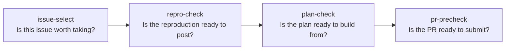

# OSS Contribution Agent

A set of four AI agent skills for [Claude Code](https://claude.com/claude-code) that check every stage of an open-source contribution, from picking an issue to opening the pull request. Each skill grades your work against a written rubric, backs every check with evidence gathered live from GitHub, and returns a structured JSON verdict: **accept** (ready to go) or **reject** (hold, with the reason).

The goal is to catch the mistakes that get first contributions ignored or closed before a maintainer ever sees them: picking an abandoned or already-claimed issue, posting a reproduction nobody can rerun, planning a fix that targets the symptom, or opening a PR that silently does more than it promised.

## The pipeline



| Skill | Question it answers | What its rubric checks |
|---|---|---|
| [`issue-select`](skills/issue-select) | Should a newcomer take this issue? | Maintainer is active, repo is in use, scope is bounded, issue is unclaimed, contribution/AI policy permits the work |
| [`repro-check`](skills/repro-check) | Is this claim + reproduction ready to post? | Claim is specific and honest, environment is recorded, a stranger can rerun it, the artifact shows the issue's behavior, the conclusion matches the evidence, comms follow repo policy |
| [`plan-check`](skills/plan-check) | Is this fix plan ready to post and build from? | Diagnosis follows the reproduction, scope is bounded to the cause, approach is executable, test plan proves the behavior, unknowns are stated honestly, comment fits the thread |
| [`pr-precheck`](skills/pr-precheck) | Is this pull request ready to submit? | Plan fidelity (no silent drift), observable test evidence, a reviewable diff, PR template and disclosure requirements met |

## How it works

Each skill is a folder of Markdown that Claude Code loads as an [agent skill](https://docs.claude.com/en/docs/claude-code/skills):

- **`SKILL.md`**: the frame. It tells the agent what to read, in what order, what to refuse, and what to output.
- **`rubric.md`**: the judgment. A table of checks, each with the evidence to gather, a pass condition someone else could apply and get the same answer, and a weight (`required` or `preferred`), followed by a verdict rule.
- **`references/evidence-guide.md`**: where each signal lives on GitHub (commit history, assignees, linked PRs, CONTRIBUTING, PR template) and in an eval bundle.
- **`procedure.md`** (plan-check, pr-precheck): the step-by-step grading procedure.
- **`voice-guide.md`**: rules for how comments posted upstream should read.
- **`scope.md`**: the target repository and the rules of the room. The skill refuses to grade anything outside it.

Each skill has two modes:

- **Live mode** gathers evidence with the `gh` CLI and the GitHub API and grades your real drafts and branch, for example `git diff main...HEAD` compared with your posted plan.
- **Eval mode** grades a frozen snapshot bundle using only the bundle text. This makes runs repeatable so the rubric can be regression-tested.

Every run ends with a machine-readable verdict:

```json
{
  "item": "https://github.com/codepath/pathreview-ai301-fa26-s3/issues/72",
  "checks": [
    {"name": "Maintainer alive", "grade": "pass",
     "evidence": "All 5 latest main commits authored by human collaborator, newest 4 days before today"},
    {"name": "Unclaimed", "grade": "pass",
     "evidence": "assignees: [], comments: 0, repo has 0 pull requests total"},
    {"name": "Contribution policy permits the work", "grade": "pass",
     "evidence": "CONTRIBUTING.md contains no mention of AI or generated code; PR template requires only tests, green CI, and xfail removal"}
  ],
  "verdict": "accept"
}
```

## Evaluation

Each skill was tested in eval mode against a labeled set of 20 snapshot packages. Each package had a gold accept/reject label, and the sets were built around specific failure categories. The bar was 18/20 agreement with the gold labels. When a run disagreed, I traced the wrong verdict back to the rubric rule that caused it, revised the rule, and re-ran the full set to confirm the fix didn't break other packages.

| Skill | Agreement | Failure categories covered |
|---|---|---|
| issue-select | **19/20** | claimed, dead repo, contribution policy, scope, clear accept |
| repro-check | **20/20** (from 17/20) | wrong target, no evidence, unfollowable comms, disclosure, clear accept |
| plan-check | **20/20** (from 19/20) | wrong cause, scope creep, unbuildable, thread convention, clear accept |
| pr-precheck | **20/20** | silent drift, not tested, unreviewable, standards wall, clear accept |

Full run logs are in [`evals/`](evals).

Example fix: repro-check first rejected an honest *cannot-reproduce* report because the evidence didn't show the bug. The rule was wrong, not the report: an honest, evidenced cannot-reproduce result is a valid outcome. I revised the artifact check to judge the evidence against the report's *stated* outcome, and the set went from 17/20 to 20/20.

## Case study: a real fix with the toolkit

I used the full pipeline on a real authentication bug in a FastAPI project ([issue #72](https://github.com/codepath/pathreview-ai301-fa26-s3/issues/72)). `verify_password` raised `passlib.exc.UnknownHashError` on a malformed stored hash instead of failing closed with `False`.

1. **Select:** `issue-select`, run live, accepted the issue with all five required checks passing (the verdict above is from that run).
2. **Reproduce:** the claim and [reproduction comment](https://github.com/codepath/pathreview-ai301-fa26-s3/issues/72#issuecomment-5862742910) record OS, Python, passlib and bcrypt versions, the commit, and exact commands. These are the things `repro-check` requires.
3. **Plan:** a narrow [plan](https://github.com/codepath/pathreview-ai301-fa26-s3/issues/72#issuecomment-5987002601) to catch only `UnknownHashError`, enable the existing regression test, and leave all other exceptions visible. This is the bounded scope `plan-check` grades for.
4. **Submit:** the PR keeps its diff to the two planned files, includes before/after test evidence, and fills in every section of the repository's PR template, including AI-use disclosure. These are the four families `pr-precheck` checks.

Result: [PR #127](https://github.com/codepath/pathreview-ai301-fa26-s3/pull/127). The regression test went from XFAIL to PASSED, 376 unit tests pass, and all 5 CI jobs are green (lint, typecheck, unit, integration, frontend).

## Install and use

Requires [Claude Code](https://claude.com/claude-code) and the [GitHub CLI](https://cli.github.com/) (`gh auth login`).

```sh
git clone https://github.com/Mouni1205/oss-contribution-agent.git
cp -R oss-contribution-agent/skills/* ~/.claude/skills/
```

Set the `Repo:` line in each skill's `scope.md` to your target repository. Then, in Claude Code:

```text
/issue-select https://github.com/<owner>/<repo>/issues/<n>
/repro-check   (with your draft claim and repro comments)
/plan-check    (with your plan.md and draft plan comment)
/pr-precheck   (from your fix branch, with plan.md, test_evidence.md, pr_draft.md)
```

To make a skill your own, edit its `rubric.md`. The frame only executes the rubric, so changing a pass condition changes the behavior.

## Repository layout

```text
skills/
  issue-select/   SKILL.md, rubric.md, scope.md, references/evidence-guide.md
  repro-check/    + voice-guide.md
  plan-check/     + procedure.md, voice-guide.md
  pr-precheck/    + procedure.md, voice-guide.md
evals/            eval run logs, one per skill
```

## Acknowledgements

Built during CodePath's AI301 course (Fall 2026). The course provided the starting skill frames for the first three skills and the labeled eval sets. I wrote the rubrics, grading procedures, voice guides, most of the evidence guides, and the `pr-precheck` frame, and tuned them through the eval runs above.
